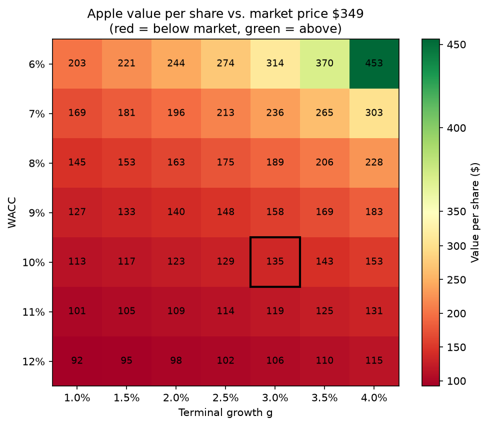
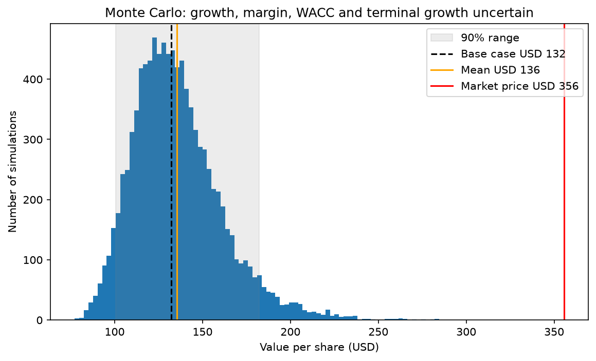

# DCF Valuation of Apple Inc. (AAPL)

A discounted cash flow (DCF) model of Apple built in Python, using financial data from Yahoo Finance.
Beyond the base-case valuation, it includes an own beta regression, a sensitivity analysis, a reverse DCF
and a Monte Carlo simulation. Data as of November 2026.

## Key results

| | |
|---|---|
| Base-case value per share | **USD 132** |
| Market price | USD 356 |
| WACC | ≈ 10.2% (own beta 1.085) |
| Terminal growth | 3.0% |
| Terminal value share of EV | 72% |
| Sensitivity range (WACC 6–12%, g 1–4%) | USD 92 – 453 |
| Implied terminal growth (reverse DCF) | ≈ 8.0% |
| Implied WACC at g = 3% (reverse DCF) | ≈ 5.7% |
| Monte Carlo 90% range (10,000 simulations) | USD 101 – 182 |
| Simulations above market price | 0 of 10,000 |

**Conclusion:** within the range of assumptions this model treats as plausible, the market price cannot be justified.
The market most likely expects strong growth for much longer than a standard 5-year forecast assumes.

### Sensitivity analysis


### Monte Carlo simulation


## Method

1. **Data:** income statement, cash flow statement and balance sheet via `yfinance`
2. **Free cash flow to the firm:** FCFF = EBIT × (1 − t) + D&A − CapEx − ΔNWC
3. **5-year forecast:** revenue-driven, with all items as % of revenue
4. **Beta and WACC:** own regression of 5 years of monthly returns against the S&P 500 (with standard errors,
   confidence interval and hypothesis tests), CAPM, WACC
5. **Terminal value:** Gordon growth model
6. **Value per share:** enterprise value → equity value (− debt + cash + investments) → per share
7. **Sensitivity analysis:** value per share across WACC and terminal growth, shown as a heatmap
8. **Reverse DCF:** terminal growth and WACC implied by the market price, solved with root-finding (`brentq`)
9. **Monte Carlo simulation:** 10,000 valuations with uncertain growth, EBIT margin, WACC and terminal growth

## Key assumptions

| Assumption | Base case | Reasoning |
|---|---|---|
| Revenue growth | 8% → 7% → 5% → 4% → 3% | FY2026 growth of 15% treated as a one-off; fades to long-run rate |
| EBIT margin | 32.5% | Between 4-year average (31.6%) and latest year (33%) |
| NWC change | median of history | Reduces the impact of extreme years (conservative) |
| D&A, CapEx | historical averages | Both stable over time |
| Equity risk premium | 5% | Standard assumption |
| Terminal growth | 3% | Consistent with year-5 growth; below long-run nominal GDP growth |

**Monte Carlo distributions** (all normal; standard deviations are judgment-based):

| Input | Mean | Std. dev. |
|---|---|---|
| Growth path (shift applied to all 5 years) | 0 | 2 points |
| EBIT margin | 32.5% | 1.5 points |
| WACC | ≈ 10.2% | 1 point |
| Terminal growth | 3% | 0.5 points (capped at WACC − 1 point) |

## Findings

- **FCF is more volatile than net income,** mainly because of working capital timing.
- **Own beta of 1.085** (SE 0.153, 95% CI 0.78–1.39) is not significantly different from 1; this uncertainty
  alone moves the cost of equity between ~8.9% and ~11.9%.
- **The valuation is most sensitive to the WACC,** and the effect of terminal growth increases sharply as the
  WACC falls, because the terminal value depends on the gap between them.
- **Five years of faster growth matter much less** than the long-run assumptions: +2 points of growth per year
  raises the value by only about USD 11, while a 1-point lower WACC adds about USD 23.
- **The market price implies** ~8% growth forever or a ~5.7% WACC; neither is plausible on its own.
- **The value distribution is right-skewed:** the Monte Carlo mean (USD 136) exceeds the median and the base case
  (USD 132), an example of Jensen's inequality.

## Limitations and next steps

- The forecast covers only five years; a **multi-stage model** with a longer high-growth phase is the natural extension.
- The Monte Carlo input distributions are judgment-based.
- Yahoo Finance data is unofficial and may contain gaps; results change as new data is downloaded.

## How to run

```
pip install -r requirements.txt
jupyter lab apple_dcf.ipynb
```

## Author

Matej Balogh — BBE student at WU Vienna, interested in quantitative finance.